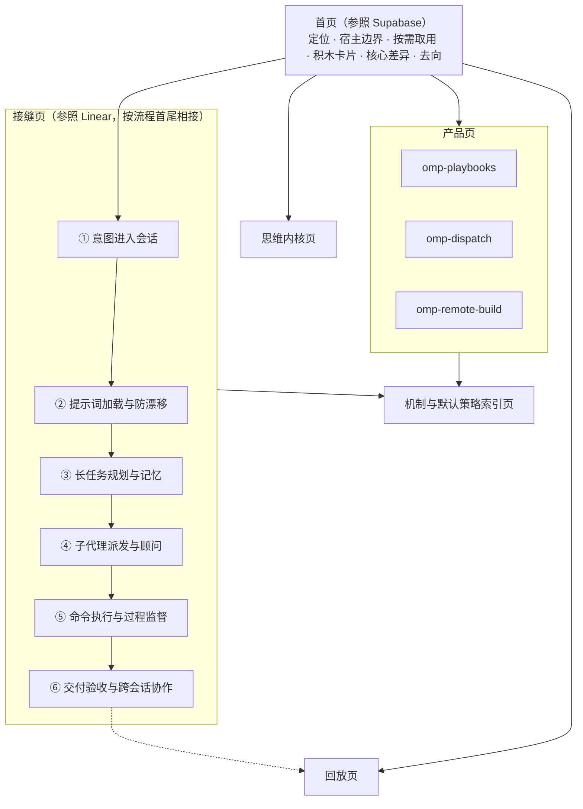

# omomp 官网内容设计

## 定位

官网是给作者本人和深度协作者看的全景架构与设计说明书：把 omomp 的思维方式、各组件在任务里的位置、设计取舍和归属边界理顺并可视化。对外推广和安装转化排在其后。

内容边界：

- 官网写认知地图和机制拆解：每个组件解决什么问题、在哪个环节起作用、哪部分是固定机制、哪部分是作者的默认策略。
- 配置字段、参数表、命令用法不搬上官网，留在各仓库的 README 和 `docs/`。深度定制交给 omp-config 的 `/onboard-omp`：它读取用户本机已有的规则和 skills，按用户的语言讲解并适配。

现有文档难懂的原因：org 主页、omp-config 的 README 和扩展文档都按仓库或扩展文件名平铺，把人看得见的面板、代理调用的工具、后台静默运行的拦截机制，以及 Playbook、Dispatch 这类独立产品放在同一张表里。读者拿到一串名词，拼不出运行时的样子。

## 叙事主线

全站由一条主线串起：

1. **全局思维方式**：omomp 自己有一套贯穿所有仓库的工程信条，先讲清楚，后面每个组件都是它的落地。
2. **意图防走样生命线 × 三层视角**：人说出的一句话要经过多次转手才变成代码，每次转手意图都可能流失。官网沿一个任务从开口到交付的接缝展开，每个接缝按三层视角标出组件。
3. **带批注的真实回放**：后台治理机制没有界面，用真实会话的时间线展示它们在何时拦下了什么。
4. **独立的重量级产品**：Playbook 这类产品自成体系，不混进日常插件，单独成区。

## 页面结构

首页和内页按不同的官网组织：首页参照 Supabase 首页，负责让读者一眼看到 omomp 由哪些可单独取用的部分组成、各自去哪里看；内页参照 Linear 的产品子页，负责沿主线把机制讲透。

### 首页

首页按 Supabase 首页的顺序组织：

| 区块 | 内容 | Supabase 首页的对应做法 |
|---|---|---|
| 定位 | 一句话说清 omomp 是什么，加一段补充 | 一句标语加一段平台说明 |
| 宿主边界 | 一张关系图交代 Oh My Pi、Tern、omomp 三者，见[宿主边界](#宿主边界) | — |
| 按需取用 | 每个插件不装 omp-config 也完整可用；omp-config 把它们接成一个受治理的运行时 | “Use it as just a Postgres database”，其余产品都包含在内但可选 |
| 积木卡片 | omp-config、各插件、独立产品各一张卡：解决什么问题、落在生命线哪个接缝，链接到对应内页；独立产品的卡片更大 | 产品逐个列出，各附一句说明 |
| 核心差异 | 四条工程信条各一句，链接到思维内核页 | Key Differentiators |
| 去向 | 按读者目标给出入口：理解思维方式、看一个任务怎么走、看真实效果、了解某个产品、改默认策略（索引页或 `/onboard-omp`） | “What do you want to do?” 目标与去处对照 |

### 内页

思维内核页、接缝页、回放页、产品页、索引页都按 Linear 产品子页（如 [linear.app/plan](https://linear.app/plan)）的结构组织：一页一个主题；标题是一句陈述；页内分几个大节，每节下有几条要点，配一块真实界面切片；页尾按流程链接相邻页面。

- **思维内核页**：每条工程信条一个大节，见[四条工程信条](#四条工程信条)。
- **接缝页**：每个接缝一页，页内按人机交互面、代理原语层、静默治理层分节；页尾链接上一个和下一个接缝，第六个接缝之后链接回放页。
- **回放页、产品页、索引页**：内容见下文对应章节。

## 一、底座与思维内核

### 宿主边界

首页用一张关系图交代三者：

| 对象 | 角色 |
|---|---|
| [Oh My Pi](https://github.com/can1357/oh-my-pi)（`omp`） | 终端编码代理宿主，提供会话、工具、子代理、扩展和插件机制 |
| Tern | 图形化终端宿主，承载插件的可视化面板（Todo 编辑器、终端 HUD、Playbook 卡片、全屏提问） |
| omomp | 叠在两者之上的运行时治理配置（omp-config）和一组插件、独立产品 |

### 四条工程信条

| 信条 | 解决的问题 | 落地方式 |
|---|---|---|
| 增量追加，保持提示前缀不变 | 钩子改写 system prompt 或中途增减工具，会让相邻请求的前缀不一致，击穿提示缓存；代理自己发起的轮次还会漏掉定制 | omp-config 的扩展不改写宿主 system prompt，定制以 `<system-reminder>` 增量消息追加；`repo-rules` 用相对仓库根的路径投递规则，worktree 之间前缀一致；插件在会话起点按规范顺序一次写定启用工具，中途变化只发差分消息 |
| 不靠静态提示词，靠可观测信号纠偏 | 模型遇到前后矛盾的提示词会直接忽略；长会话中会逐步忽略静态 system prompt | 先消除提示词内部的重复和冲突（`SYSTEM_TEMPLATE.md`、`tool-topics`、`system-prompt-replace`），再把工具误用、未隔离的并发写入、未验证就交付、只说不做就收工当作偏离信号，在工具调用、工具结果、子代理交付和回合结束处阻断或提醒 |
| 权威源头单一，编排、执行、顾问分离 | 主代理写派工 prompt 时会把自己的假设带给子代理；按钮或子代理自治过多会越过主代理造成状态分裂 | 执行侧只用无状态的 `task:*` 档位；顾问 `discuss:*`、`mentor:default` 由 `user-prompt-inject` 直接拿到用户原话，并以只读或无工具限权；Playbook 的按钮只是发给协调者的请求 |
| 机制与默认策略分离 | 把个人工作流写死进扩展会变成黑盒；只靠自然语言规则又没有运行时约束力 | 扩展只提供带作用域条件的机制，仓库随附的替换规则、追加片段、回合判定、子代理定义都是可运行的示例；更新器三方合并保留本机定制；插件不装 omp-config 也完整可用 |

## 二、意图防走样生命线

一个任务从人开口到交付要经过六个接缝。每个接缝一页，按三层视角标出组件：

- **人机交互面**：人在终端或 Tern 面板里直接看见、点击、作答的界面。
- **代理原语层**：编程代理相对原生 `omp` 多出来的工具、URL 协议和子代理角色。
- **静默治理层**：人平时看不见，在后台钩子里阻断违规或发起判定的机制。

| 接缝 | 人机交互面 | 代理原语层 | 静默治理层 |
|---|---|---|---|
| ① 意图进入会话 | `omp-ask-more` 全屏决策面板（现状、决定、后果，代码证据、示意图、演示动画）；`input-polish` 改写输入 | 结构化 `ask`：每个选项写明取舍 | `ask-more` 的可读性检查退回含糊的提问；路由规则要求所有问题走面板 |
| ② 提示词加载与防漂移 | `omp` 完整模式与 `omp-light` 轻量模式两个入口 | `tool://` 与 `xd://` 按需读取工具专题 | `SYSTEM_TEMPLATE.md` 去重、`tool-topics` 压缩工具说明、`system-prompt-replace` 修补冲突措辞、`repo-rules` 按路径投递规则 |
| ③ 长任务规划与记忆 | `omp-todo-more` 的 Tern 待办面板 | 结构化 `todo`（目标、阶段、时间预算、完成即提交）、`ctx` 回顾、`fork_task` 复制完整对话前缀 | 未完成项的停止提醒；`model-compaction` 按模型推迟有损压缩 |
| ④ 子代理派发与顾问 | `/subagent-usage` 授权本机用量校准 | 按成本与可信度分档的 `task:*`、保守的 `discuss:steady`、发散的 `discuss:divergent`、无工具的 `mentor:default`、剩余派发次数估算 | `user-prompt-inject` 把用户原话注入顾问；`isolation-nudge` 拦截未隔离的并发写者；`task-split-check` 拦截多主题混派和限制报告长度 |
| ⑤ 命令执行与过程监督 | `omp-unified-exec` 的 Tern 终端 HUD，人可旁观并向同一终端输入；`/watchdog` 管理命令 | 长驻 PTY 会话（`exec_command`、`write_stdin`、`monitor`）、只收字面路径并默认进回收站的 `delete`、`wt` 会话工作树、`harness_restart` | `delete-guard` 拦截 shell 与 eval 中的删除和非字面执行；`tool-policy-nag` 阻断交互和长驻命令走 `bash`，并对工具误用追加提醒；`watchdog-agent` 定期抽查 |
| ⑥ 交付验收与跨会话协作 | `omp-thinking-translator` 流式翻译思考块；`omomp-lang` 统一界面语言 | `omp-sessions`（`session://` 与 `session_query` SQL）、`omp-peers`（跨进程发现、旁路询问、IRC 消息） | `task-completion-judge` 在子代理交付时核对范围、验证和 Todo；`turn-judge` 在主代理只说不做就收工时要求继续；`lang-nag` 纠正回复语言 |

### 带批注的真实回放

静默治理层没有界面，生命线之后接一段回放：以一次真实的多文件任务为时间轴，在关键帧并排展示“会话里发生了什么”和“没有 omomp 会怎样”。每一帧都取自真实会话记录或现有录屏，不编造；素材可用 `omp-sessions` 从会话记录中检索，ask-more、unified-exec、playbooks 的 README 已有真实录屏可直接复用。

计划寻找的镜头：

| 帧 | 镜头 | 体现的机制 |
|---|---|---|
| 1 | 需求澄清：模型的含糊提问先被退回，补全后才弹出全屏决策面板 | `omp-ask-more` |
| 2 | 顾问会商：顾问对照用户原话，指出主代理草案漏掉的约束 | `user-prompt-inject`、`discuss:*` |
| 3 | 派发拦截：一个子代理被塞进两个无关主题，并被要求“简短汇报” | `task-split-check` |
| 4 | 长会话偏离：模型改用 shell 读文件和删除，被拒止或在结果末尾收到提醒，下一轮恢复使用专用工具 | `delete-guard`、`tool-policy-nag` |
| 5 | 人机同屏终端：代理启动长驻进程，人在 Tern 终端 HUD 里介入，代理接着读同一终端 | `omp-unified-exec` |
| 6 | 拒绝半途而废：子代理未验证就交付被退回；主代理宣布“接下来可以运行测试”准备收工，被要求继续 | `task-completion-judge`、`turn-judge` |

呈现形式参考 Amp 首页：长视频按章节打时间戳，附完整逐字稿。

## 三、独立重量级产品

Playbook、Dispatch、Remote Build 自成体系，各有完整的使用流程和自己的心智模型。官网把它们作为建立在 omomp 思维方式之上的独立产品，每个占一个专题页，不与日常插件并列。

| 产品 | 定位 | 专题页重点 |
|---|---|---|
| [omp-playbooks](https://github.com/oh-my-omp/omp-playbooks) | 人机共创的可执行设计文档：设计块、执行块和编排块放在同一份 YAML 里，人在 Tern 面板中把块当卡片编辑，主会话负责编译和启动子代理 | 人、协调者、文档服务、子代理四方的职责边界，以及“按钮是请求，不是自动执行器”；串联仓库 README 里从打开、协同设计、整理执行块、启动监督到编排交接的录屏 |
| [omp-dispatch](https://github.com/oh-my-omp/omp-dispatch) | GitHub issue 图交付引擎：持久票据按工作流状态机推进，每次交付由一次性 owner 会话完成，由全新的独立判定者把关 | 从 issue 里的链接或 GitHub App 事件启动协调者的端到端流程；为什么判定必须对准具体 commit、由新会话完成；复用仓库 README 的真实 issue 树交付录屏 |
| [omp-remote-build](https://github.com/oh-my-omp/omp-remote-build) | 按 worktree 隔离的远端构建环境：本地照常编辑，Mutagen 单向同步到远端主机，在 Komodo 管理的容器里编译、测试 | 本地 worktree、Mutagen、Komodo、远端容器的关系图；项目如何用一个配置文件选择接入 |

`omp-codex-image-gen` 等单一功能插件放在页面末尾的工具区，一张卡片一句话。

## 四、机制与默认策略索引

索引页回答“这个组件哪部分是固定的、哪部分是作者的选择、我要改去哪里”。每个可定制组件一行，三列：

- **机制**：随仓库发布、用户通常不改的部分。
- **作者默认策略**：仓库随附的可运行示例，体现作者的模型选择和工作习惯。
- **定制入口**：链接到该组件在仓库 `docs/` 或 README 中的章节，或指向 `/onboard-omp`。

示例：

| 组件 | 机制 | 作者默认策略 |
|---|---|---|
| `system-prompt-replace` | 按会话、模型、模式等条件匹配宿主提示词原文，以增量消息声明替换或停用 | 移除与子代理 Todo 冲突的句子，禁止在 `eval` 中检索本地文件 |
| `append-system-model` | 按条件把提示词片段追加为增量消息 | 完整模式的主会话在重大决策时咨询两个讨论顾问，长调查前后咨询导师 |
| 子代理档位 | 无状态执行档位、只读或无工具顾问、结构化交付 | 各档位绑定不同订阅和模型，以模型互补和分摊成本 |
| `turn-judge` | 回合结束时用一组是非题判定本轮回复，命中规则即注入提醒 | 针对 GPT 主会话“说还有事没做却停下”的提前收工 |
| `tool-policy-nag` | 依据实际执行轨迹判定工具误用，分阻断、计数提醒、意图判定、静默失败检测几个通道 | 启发式检测，违规达到阈值后在结果末尾附提醒 |

## 参考官网

以下官网的结构可借鉴；其中 Supabase 是首页的视觉基准，Linear 是内页的视觉基准，见[视觉基准](#视觉基准)。

| 官网 | 借鉴点 | 对应板块 |
|---|---|---|
| [linear.app](https://linear.app/) | 首页先给三条原则，再沿产品开发流程分屏（Intake → Planning → AI → Build）；产品子页一页一个主题，页尾按流程链接相邻页面 | 内页：思维内核页与接缝页 |
| [ampcode.com](https://ampcode.com/) | 首页主体是一段按章节打时间戳、附完整逐字稿的真实工作录像 | 带批注的真实回放 |
| [charm.land](https://charm.land/) | 一个组织下的旗舰产品各占一屏，基础库成卡片区，零散工具放末尾 | 首页积木卡片里独立产品与插件的分区 |
| [obsidian.md](https://obsidian.md/) | 三句立场各配一行机制说明，同步、发布作为独立产品单列 | 思维内核页开头 |
| [nixos.org](https://nixos.org/) | 三根支柱做标题，下面分出两个产品 | 思维内核与产品形态分开 |
| [temporal.io](https://temporal.io/) | 先抛痛点、给演示，再逐层拆解机制；讲的是看不见的保障 | 静默治理层的讲法 |
| [supabase.com](https://supabase.com/) | 首页先讲每个产品可单独使用，再列产品、核心差异和按目标的去处 | 首页 |

反例：只有一面仓库或插件卡片墙、没有定位和去向的目录式首页，也就是 omomp 现有 org 主页的形态。

## 视觉与技术路线

### 视觉基准

- **首页参照 [supabase.com](https://supabase.com/)**：可单独取用的积木卡片、按需取用的说法、按目标的去向。
- **内页参照 [linear.app](https://linear.app/) 的产品子页**：一页一个主题、分节要点配真实界面的动态切片、页尾按流程衔接。

配色、字体、间距和动效在动手前分别对照 Supabase 首页和 Linear 子页整理成设计规范。界面切片里出现的内容取自真实会话和真实界面，与[维护约束](#维护约束)一致。

### 技术路线

- 用 Astro 生成静态站点，不依赖服务端运行。
- 页面默认是静态内容；生命线动画、回放时间轴、界面切片这类交互部分做成 Astro island，全站只用一种 UI 框架。
- 接缝、组件、产品这些结构化内容放进 Astro 内容集合，由 schema 约束字段；机制与默认策略索引由这些数据生成，不手写表格。
- 关键图（首页的宿主边界图、接缝页的生命线与三层视角图）按视觉基准定制绘制，不用 mermaid 默认样式；mermaid 只用于索引等次要页面，并在构建时渲染成 SVG。
- 录屏视频放在站点自己的存储里，不直接嵌入 GitHub 附件链接：用 curl 不带登录请求 omp-ask-more README 里的 `github.com/user-attachments/assets/...` 录屏链接，返回 404，外站无法直接播放。

## 维护约束

- 不写集合的数量（几个扩展、几个插件），写出名字或链接到列出它们的文件。
- 不搬参数表、配置字段、超时和阈值；这些随代码变化，留在各仓库。
- 每个组件在官网上只有名字、它解决的问题、它在生命线上的位置和指向仓库的链接。
- 能复用仓库已有的真实录屏就复用，不另做示意动画冒充运行结果。

## 待定事项

- 语言：只做中文，还是中英双语。
- island 使用的 UI 框架：React 或 Svelte。
- 托管方式，以及是否使用自定义域名。
- 回放素材：从哪些真实会话中选取，如何脱敏。
- 独立产品与安装清单的关系：omp-config 的 `install-plugins.sh` 目前默认安装 `omp-playbooks`、不含 `omp-dispatch`，`omp-remote-build` 是注释掉的可选项；官网按产品分量把三者作为独立产品呈现，安装清单是否随之调整另行决定。
