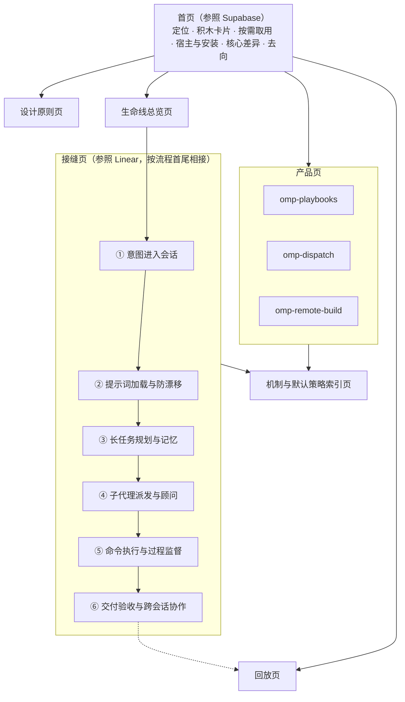

# omomp 官网内容设计

## 定位

官网是给作者本人和深度协作者看的全景架构与设计说明书：把 omomp 的思维方式、各组件在任务里的位置、设计取舍和归属边界理顺并可视化。对外推广和安装转化排在其后。

内容边界：

- 官网写认知地图和机制拆解：每个组件解决什么问题、在哪个环节起作用、哪部分是固定机制、哪部分是作者的默认策略。
- 配置字段、参数表、命令用法不搬上官网，留在各仓库的 README 和 `docs/`。深度定制交给 omp-config 的 `/onboard-omp`：它读取用户本机已有的规则和 skills，按用户的语言讲解并适配。

现有文档难懂的原因：org 主页、omp-config 的 README 和扩展文档都按仓库或扩展文件名平铺，把人看得见的面板、代理调用的工具、后台静默运行的拦截机制，以及 Playbook、Dispatch 这类独立产品放在同一张表里。读者拿到一串名词，拼不出运行时的样子。

## 叙事主线

全站由一条主线串起：

1. **全局思维方式**：omomp 自己有一套贯穿所有仓库的工程信条，先讲清楚，后面每个组件都是它的落地。
2. **意图防走样生命线 × 三层视角**：人说出的一句话要经过多次转手才变成代码，每次转手意图都可能流失。官网沿一个任务从开口到交付的接缝展开，每个接缝按三层视角标出组件。
3. **一条任务贯穿的模拟演示**：后台治理机制没有界面，用一个读者一眼能懂的开发任务演示它们：左边是人在终端或 Tern 里看到的画面，右边是同一时刻送到模型、却不出现在屏幕上的消息。
4. **独立的重量级产品**：Playbook 这类产品自成体系，不混进日常插件，单独成区。

## 页面结构

首页和内页按不同的官网组织：首页参照 Supabase 首页，负责让读者一眼看到 omomp 由哪些可单独取用的部分组成、各自去哪里看；内页参照 Linear 的产品子页，负责沿主线把机制讲透。

### 首页

首页按 Supabase 首页的顺序组织：

| 区块 | 内容 | Supabase 首页的对应做法 |
|---|---|---|
| 定位 | 首屏矮而不对称：左列两行实色标题，第二行用强调色，下面两个入口；右列三行平实导语，说清 omomp 叠在 Oh My Pi 与 Tern 之上、加了什么 | 左列双色标语与按钮，右列平实的平台说明 |
| 积木卡片 | 紧接首屏、在第一屏内开始的 Bento 网格：omp-config、各插件、独立产品和工具各一张卡，约三成面积写名字、类别、所在接缝和一句话，其余是这个仓库工作时的界面切片。omp-config 是占满一行的主卡，左边写职责，右边是六道接缝 × 三层的钩子管道，标出追加、拦下和裁决；三个独立产品是大卡 | 产品 Bento 网格，主卡跨列，每张卡大半面积是该产品的微缩界面 |
| 按需取用 | Bento 正下方一句桥接语：单装一个插件，或整套接入 | “Use one or all.” 一行 |
| 宿主与安装 | 一个可切换的舞台：单装插件、接入 omp-config 完整治理、搭配 Tern 图形终端三种方式各一页，左边是这种方式下实际看到的工作界面和三者的挂载关系，右边是安装和启动命令、说明和装好之后得到什么；见[宿主边界](#宿主边界) | 胶囊切换的交互舞台，配可切换的代码框 |
| 核心差异 | 四条工程信条各一格，配原则页同一张架构图的缩略版，链接到设计原则页 | Key Differentiators |
| 去向 | 细线分隔的问答列表，按读者的问题给出入口：一个需求会经历什么、意图会在哪里走样、为什么这样设计、哪些是独立产品、哪些可以改、代码在哪里 | “What do you want to do?” 目标与去处对照 |

### 内页

设计原则页、生命线总览页、接缝页、回放页、产品页、索引页都按 Linear 产品子页（如 [linear.app/plan](https://linear.app/plan)）的结构组织：

- 一页一个主题，页首一行浅灰眉题加一句陈述式标题。
- 每个大节的节头左右不对称：左列标题，右列导语和跳转链接；标题本身已说清这一节时不配导语，标题占用更宽的左侧。
- 节头下是一块全宽的界面舞台，直接画出这一节机制运行时的样子。
- 子要点放在细线分隔的网格里，每格上部大半面积是局部的界面或协议切片，下部是一行标题和至多两行说明；说明写不下就改短文案，不截断。
- 页尾按流程链接相邻页面。

各页的内容：

- **设计原则页**：页首导语一句话列出四条约束，下方用图例说明三层的颜色。第一节把四张架构图（FIG 0.1–0.4）排成细线分隔的四列，每列是编号、图、短标题和一句摘要。之后每条工程信条一个大节：节头列出落实它的组件并链接到所在接缝页，节下的舞台左侧是三条做法的切换项，右侧是所选做法对应的真实界面或送到模型的消息原文，不重复架构图；见[四条工程信条](#四条工程信条)。
- **生命线总览页**：第一节的舞台按接缝分列，列出演示里每道接缝的步骤和在那里送到模型的消息；舞台下是六格接缝卡片，上部是这道接缝的代表切片，下部是接缝名和一句话，链接到各接缝页。第二节把接缝为列、三层为行的组件图放在舞台里，行标写层名和这一层是什么；选中一个组件就在它旁边展开那一句说明，以及仓库和接缝页链接。
- **接缝页**：页首是六道接缝的导航条，当前接缝高亮；先是演示里属于这道接缝的几步，节头标题点明接缝名；再按人机交互面、代理原语层、静默治理层各一节，节头眉题是层名，标题是这一层在这道接缝做的事。每节一张细线网格，一格一个组件：上部是它工作时的切片，下部是名字和一句话；只有一个组件的层改为左文右图的宽格。页尾链接上一个和下一个接缝，第六个接缝之后链接回放页。
- **回放页、产品页、索引页**：内容见下文对应章节。

## 一、底座与设计原则

### 宿主边界

首页的宿主与安装舞台交代三者：

| 对象 | 角色 |
|---|---|
| [Oh My Pi](https://github.com/can1357/oh-my-pi)（`omp`） | 终端编码代理宿主，提供会话、工具、子代理、扩展和插件机制 |
| Tern | 图形化终端宿主，承载插件的可视化面板（Todo 面板、终端视图、全屏提问、Playbook 卡片） |
| omomp | 叠在两者之上的运行时治理配置（omp-config）和一组插件、独立产品 |

三种安装方式：单装一个插件时只用到插件和 `omp`；接入 omp-config 时插件统一受共用的检查约束，入口是 `/onboard-omp`；在 Tern 里运行时插件把面板画在 Tern 中。

### 四条工程信条

| 信条 | 解决的问题 | 落地方式 |
|---|---|---|
| 增量追加，保持提示前缀不变 | 钩子改写 system prompt 或中途增减工具，会让相邻请求的前缀不一致，击穿提示缓存，已发过的上下文要重新计费 | 会话开始后宿主 system prompt 保持原样，提示词修改、规则和工具说明都以 `<system-reminder>` 增量消息追加；`repo-rules` 以相对仓库根的路径投递 AGENTS.md 与 CLAUDE.md，同一仓库的检出与各 worktree 前缀一致；插件在会话起点按规范顺序一次写定启用工具，中途变化只发差分消息 |
| 不靠静态提示词，靠可观测信号纠偏 | 模型遇到前后矛盾的提示词会直接忽略；长会话中会逐步忽略静态 system prompt | 先消除提示词内部的重复和冲突（`SYSTEM_TEMPLATE.md`、`tool-topics`、`system-prompt-replace`），再把工具误用、未隔离的并发写入、未验证就交付、只说不做就收工当作偏离信号，在工具调用、工具结果、子代理交付和回合结束处阻断或提醒 |
| 权威源头单一，编排、执行、顾问分离 | 主代理写派工 prompt 时会把自己的假设带给子代理；按钮或子代理自治过多会越过主代理造成状态分裂 | 执行侧只用无状态的 `task:*` 档位；顾问 `discuss:*`、`mentor:default` 由 `user-prompt-inject` 直接拿到用户原话，并以只读或无工具限权；Playbook 的按钮只是发给协调者的请求 |
| 机制与默认策略分离 | 把个人工作流写死进扩展会变成黑盒；只靠自然语言规则又没有运行时约束力 | 扩展只提供带作用域条件的机制，仓库随附的替换规则、追加片段、回合判定、子代理定义都是可运行的示例；更新器三方合并保留本机定制；插件不装 omp-config 也完整可用 |

四张架构图各画一条信条的结构：FIG 0.1 对比原地改写 system prompt 与锁定前缀、尾部追加时的请求字节流；FIG 0.2 画工具调用、工具结果、子代理交付、回合结束四个挂载点如何捕获偏离并送回拦截或提醒；FIG 0.3 画用户原话直达只读顾问、主代理向无状态执行者派发的权限边界；FIG 0.4 画随仓库发布的固定机制与作者默认策略经三方合并保留本机改动。

## 二、意图防走样生命线

一个任务从人开口到交付要经过六个接缝。每个接缝一页，按三层视角标出组件：

- **人机交互面**：人在终端或 Tern 面板里直接看见、点击、作答的界面。
- **代理原语层**：编程代理相对原生 `omp` 多出来的工具、URL 协议和子代理角色。
- **静默治理层**：人平时看不见，在后台钩子里阻断违规或发起判定的机制。

| 接缝 | 人机交互面 | 代理原语层 | 静默治理层 |
|---|---|---|---|
| ① 意图进入会话 | `omp-ask-more` 全屏决策面板（现状、决定、后果，代码证据、示意图、演示动画）；`input-polish` 改写输入 | 结构化 `ask`：每个选项写明取舍 | `ask-more` 的可读性检查退回含糊的提问；路由规则要求所有问题走面板 |
| ② 提示词加载与防漂移 | `omp` 完整模式与 `omp-light` 轻量模式两个入口 | `tool://` 与 `xd://` 按需读取工具专题 | `SYSTEM_TEMPLATE.md` 去重、`tool-topics` 压缩工具说明、`system-prompt-replace` 修补冲突措辞、`repo-rules` 按路径投递规则 |
| ③ 长任务规划与记忆 | `omp-todo-more` 的 Tern 待办面板 | 结构化 `todo`（目标、阶段、时间预算、完成即提交）、`ctx` 回顾、`fork_task` 复制完整对话前缀 | 未完成项的停止提醒；`model-compaction` 按模型推迟有损压缩 |
| ④ 子代理派发与顾问 | `/subagent-usage` 授权本机用量校准 | 按成本与可信度分档的 `task:*`、保守的 `discuss:steady`、发散的 `discuss:divergent`、无工具的 `mentor:default`、剩余派发次数估算 | `user-prompt-inject` 把用户原话注入顾问；`isolation-nudge` 退回会让多个改文件的子代理共用工作区、又没写明是否隔离的派发；`task-split-check` 拦截多主题混派和限制报告长度 |
| ⑤ 命令执行与过程监督 | `omp-unified-exec` 的 Tern 终端视图，人可旁观并向同一终端输入；`/watchdog` 管理命令 | 长驻 PTY 会话（`exec_command`、`write_stdin`、`monitor`）、只收字面路径并默认进回收站的 `delete`、`wt` 会话工作树、`harness_restart` | `delete-guard` 拦截 shell 与 eval 中的删除和非字面执行；`tool-policy-nag` 阻断交互和长驻命令走 `bash`，其他误用照常执行并在结果末尾追加提醒；`watchdog-agent` 按动作数定期审查用户定义的会话 |
| ⑥ 交付验收与跨会话协作 | `omp-thinking-translator` 流式翻译思考块；`omomp-lang` 统一界面语言 | `omp-sessions`（`session://` 与 `session_query` SQL）、`omp-peers`（跨进程发现、旁路询问、IRC 消息） | `task-completion-judge` 在子代理交付时核对范围、验证和 Todo；`turn-judge` 在主代理只说不做就收工时要求继续；`lang-nag` 在下一轮纠正用错的回复语言 |

每个组件在接缝页的网格里只出现一次：名字、一句写清触发时机、动作和结果的话、指向仓库的链接，以及它工作时的切片。人机交互面的切片是它的面板或命令，代理原语层是一次调用和返回，静默治理层是模型收到的那条消息。

### 模拟演示

静默治理层没有界面，生命线之后接一段模拟演示。场景是一个读者一眼能懂的开发任务：给一个小型 API 服务 `shop-api` 加基于 Redis 的按 API key 限流中间件，超额返回 429 和 Retry-After，再把 orders、search、webhooks 三个路由改成走这个中间件。中英文各写一版，各自用地道的语言，不出现内部编号、探针路径和调试日志。

演示分步推进，按接缝顺序排列：

| 接缝 | 步骤 | 人看到的 | 送到模型的 |
|---|---|---|---|
| ① | 提出需求 | 需求和一次被退回的提问调用 | `omp-ask-more` 可读性检查退回含糊的草稿 |
| ① | 你来决定 | 全屏决策面板：现状、决定、后果、带取舍的选项、代码证据 | 无 |
| ② | 规则随文件到达 | 读文件的调用，以及前缀不变、命中缓存的请求示意 | `repo-rules` 按路径追加的规则 |
| ③ | 计划 | 待办面板：目标、阶段、估时 | 无 |
| ③ | 提前停下 | 一行未完成提醒卡片，已完成项带提交 | `omp-todo-more` 的停止提醒 |
| ④ | 三个写手，一个工作区 | 被拦下的派发调用 | `isolation-nudge` 的提醒 |
| ④ | 执行者与顾问 | 三个独立 worktree 里的执行者和一位顾问 | `user-prompt-inject` 送给顾问的用户原话和 ask 回答 |
| ⑤ | 不会结束的命令 | 被拒绝的 `tail -f` | `tool-policy-nag` 的 pty 路由拒绝 |
| ⑤ | 共用终端 | 终端视图：代理启动的测试监视，人在其中输入 | 无 |
| ⑤ | 删除留下记录 | 被拦下的 `rm -rf` 和改用 `delete` 的结果 | `delete-guard` 的拒绝 |
| ⑥ | 执行者说做完了 | 一个执行者的交付被退回 | `task-completion-judge` 的退回 |
| ⑥ | 只说不做 | 代理宣布下一步后停下，被送回继续 | `turn-judge` 的提示 |
| ⑥ | 完成，附证据 | 思考译文、测试通过、提交和带证据的汇报 | 无 |

演示是为官网编写的模拟，但界面结构和标签取自各插件的真实界面，送到模型的每条消息都按对应扩展源码里的模板逐字填写。模板只有一种语言时，两版页面都照原文呈现，并在下方附上该页语言的译文。

回放页是完整的演示播放器：打开时停在第一步并完整显示，步骤条按接缝分组、可直接点选，也可以播放或逐步前后翻。播放按拍推进：按下即开始，人看到的画面一行一行、一块一块出现，钩子在它针对的那一行或那块面板出现之后立刻在右屏出现，两者同时以钩子的色调高亮；一步播完接下一步，进度条同时标出整段和当前一步的位置。左右两屏高度固定在视口之内，各自在框内跟随最新一拍滚动，变化不会发生在视口外；窄屏上下堆叠。暂停时跳到某一步显示整步，播放时跳过去从这一步的第一拍开始。右屏没有消息时写明这一步没有追加内容。每个接缝页内嵌属于它的那几步，步骤按钮直接放在播放器标题行里；计步始终对照整段演示，例如“第 8 步，共 13 步”。

## 三、独立重量级产品

Playbook、Dispatch、Remote Build 自成体系，各有完整的使用流程和自己的心智模型。官网把它们作为建立在 omomp 思维方式之上的独立产品，每个占一个专题页，不与日常插件并列。产品页的示例沿用演示里的 `shop-api` 限流任务。

| 产品 | 定位 | 专题页主舞台 |
|---|---|---|
| [omp-playbooks](https://github.com/oh-my-omp/omp-playbooks) | 人机共创的可执行设计文档：设计块、执行块和编排块放在同一份 YAML 里，人在 Tern 面板中把块当卡片编辑，主会话负责编译和启动子代理 | 同一份 Playbook 的 YAML 与 Tern 卡片并排：设计块、执行块、编排块，已请求启动和运行中的块，协调者在线状态，以及写回 YAML 的状态 |
| [omp-dispatch](https://github.com/oh-my-omp/omp-dispatch) | GitHub issue 图交付引擎：持久票据按工作流状态机推进，每次交付由一次性 owner 会话完成，由全新的独立判定者把关 | issue 里的入口链接、issue 树、一张工单在默认工作流状态轨上的位置，以及新提交让旧批准作废、判定钉到新 head 的过程 |
| [omp-remote-build](https://github.com/oh-my-omp/omp-remote-build) | 按 worktree 隔离的远端构建环境：本地照常编辑，Mutagen 单向同步到远端主机，在 Komodo 管理的容器里编译、测试 | 本机的几个 worktree 与各自的配置文件、单向同步、远端容器里由容器工具打开的测试终端 |

主舞台之下，“运作方式”用一张细线网格写产品的几条关键机制，每格上部是该机制产出的文件、消息或状态，下部是标题和两句说明；“谁负责什么”在一个舞台框里画出一方居中、其余各方围绕它的关系，每条连线标明经过它的内容，箭头按实际方向画，不画成单向链条。两节都用左右分栏的节头。页首标题是一句短标题，不带句号；三个产品页的页头用一组分段切换器并列全部产品，可直接互相切换，仓库链接与它分开。

`omp-codex-image-gen` 等单一功能插件作为工具，在首页积木区占一张卡片。

## 四、机制与默认策略索引

索引页回答“这个组件哪部分是固定的、哪部分是作者的选择、我要改去哪里”。第一节用一个随附的默认设定文件（`turn-judge` 判定 GPT 主会话只说不做的文件，正是演示里送回代理的那条）配三方合并示意图，说明默认设定就是可以改写或删除的文件，更新时保留本机改动。文件摘录保持原文，下方用页面语言说明其中的判定问题和中文提示词。第二节的节头放六道接缝的跳转胶囊，舞台里每个可定制组件一行，按所在接缝分组，列出：

- **机制**：随仓库发布、用户通常不改的部分。
- **作者默认策略**：仓库随附的可运行示例，体现作者的模型选择和工作习惯。
- **定制入口**：链接到该组件在仓库 `docs/` 或 README 中的章节；页头指向 `/onboard-omp`。

示例：

| 组件 | 机制 | 作者默认策略 |
|---|---|---|
| `system-prompt-replace` | 按会话、模型、模式等条件匹配宿主提示词原文，以增量消息声明替换或停用 | 移除与子代理 Todo 冲突的句子，禁止在 `eval` 中检索本地文件 |
| `append-system-model` | 按条件把提示词片段追加为增量消息 | 完整模式的主会话在重大决策时咨询两个讨论顾问，长调查前后咨询导师 |
| 子代理档位 | 无状态执行档位、只读或无工具顾问、结构化交付 | 各档位绑定不同订阅和模型，以模型互补和分摊成本 |
| `turn-judge` | 回合结束时用一组是非题判定本轮回复，命中规则即注入提醒 | 针对 GPT 主会话“说还有事没做却停下”的提前收工 |
| `tool-policy-nag` | 依据实际执行轨迹判定工具误用，分阻断、计数提醒、意图判定、静默失败检测几个通道 | 启发式检测，违规达到阈值后在结果末尾附提醒 |

## 参考官网

以下官网的结构可借鉴；其中 Supabase 是首页的视觉基准，Linear 是内页的视觉基准，见[视觉基准](#视觉基准)。

| 官网 | 借鉴点 | 对应板块 |
|---|---|---|
| [linear.app](https://linear.app/) | 首页先给三条原则并各配一张架构线稿，再沿产品开发流程分屏（Intake → Planning → AI → Build）；产品子页一页一个主题，节头左右不对称，节下是全宽界面舞台和细线网格，页尾按流程链接相邻页面 | 内页：设计原则页与接缝页 |
| [ampcode.com](https://ampcode.com/) | 首页主体是一段按章节推进、附完整逐字稿的工作过程 | 模拟演示的分章与逐步播放 |
| [charm.land](https://charm.land/) | 一个组织下的旗舰产品各占一屏，基础库成卡片区，零散工具放末尾 | 首页积木卡片里独立产品与插件的分区 |
| [obsidian.md](https://obsidian.md/) | 三句立场各配一行机制说明，同步、发布作为独立产品单列 | 设计原则页开头 |
| [nixos.org](https://nixos.org/) | 三根支柱做标题，下面分出两个产品 | 设计原则与产品形态分开 |
| [temporal.io](https://temporal.io/) | 先抛痛点、给演示，再逐层拆解机制；讲的是看不见的保障 | 静默治理层的讲法 |
| [supabase.com](https://supabase.com/) | 首屏左右不对称，紧接着就是每张卡大半面积为微缩界面的产品 Bento 网格；再用切换舞台讲可单独使用，最后列核心差异和按目标的去处 | 首页 |

反例：只有一面仓库或插件卡片墙、没有定位和去向的目录式首页，也就是 omomp 现有 org 主页的形态。

## 视觉与技术路线

### 视觉基准

- **首页参照 [supabase.com](https://supabase.com/)**：不对称首屏、首屏内可见的积木 Bento 网格、卡片以界面切片为主、按需取用的切换舞台、按目标的去向。
- **内页参照 [linear.app](https://linear.app/) 的产品子页**：纯白实色标题配浅灰眉题、左右不对称的节头、全宽界面舞台、上图下文的细线网格、原则页的架构线稿。

全站用深色底，强调色取自 logo 的琥珀色，只用于少量高亮；人机交互面、代理原语层、静默治理层各用一种颜色，在生命线、接缝页、演示和索引页里一致。标题不用渐变字和发光，卡片不用彩色渐变背景，分隔用细线而不是一排排圆角灰框。界面切片按插件真实界面的结构和原文标签绘制，内容来自统一的演示场景。

文案用平实的工程语言：不写对仗口号和“不是 A，而是 B”式的句子，中文直接用中文写，不从英文硬译；中文标题靠控制字数和句子结构自然断行，不在词间插入断行标记。

### 技术路线

- 用 Astro 生成静态站点，不依赖服务端运行。英文是默认语言，放在根路径；中文放在 `/zh/` 下，两版内容逐页对应。
- 页面默认是静态内容；生命线组件图、首页的宿主与安装舞台和演示播放器做成 Astro island，全站只用 Solid 一种 UI 框架，经 Astro 官方集成 `@astrojs/solid-js` 接入。该集成目前只支持 Solid 1；Solid 2 还是 RC，它的渲染入口已拆到 `@solidjs/web`，官方集成跟进后再迁移。
- 界面切片写成 Solid 组件，静态页面和演示播放器共用同一套切片。
- 样式用 Astro 组件自带的作用域 CSS 加全局样式，不引入动画库或 CSS 框架，内容不做滚动淡入。
- 接缝、组件、产品、信条这些结构化内容放进 Astro 内容集合，由 schema 约束字段；机制与默认策略索引由这些数据生成，不手写表格。
- 关键图（宿主与安装舞台、生命线的接缝 × 三层组件图、原则页的架构图）按视觉基准定制绘制，不用 mermaid。
- 演示不用视频：按模拟场景在页面里绘制界面，由演示播放器逐步推进。
- 托管在 GitHub Pages（`https://oh-my-omp.github.io/omomp-site/`），推送到 `main` 后由 GitHub Actions 构建并发布，不用自定义域名。

## 维护约束

- 不写集合的数量（几个扩展、几个插件），写出名字或链接到列出它们的文件。
- 不搬参数表、配置字段、超时和阈值；这些随代码变化，留在各仓库。
- 每个组件在官网上只有名字、它解决的问题、它在生命线上的位置、指向仓库的链接和一块工作时的切片。
- 演示一律为官网编写，不复用插件 README 里的录屏；界面结构、标签和送到模型的消息以插件源码为准，源码改了措辞，演示随之更新。

## 待定事项

- 独立产品与安装清单的关系：omp-config 的 `install-plugins.sh` 目前默认安装 `omp-playbooks`、不含 `omp-dispatch`，`omp-remote-build` 是注释掉的可选项；官网按产品分量把三者作为独立产品呈现，安装清单是否随之调整另行决定。
